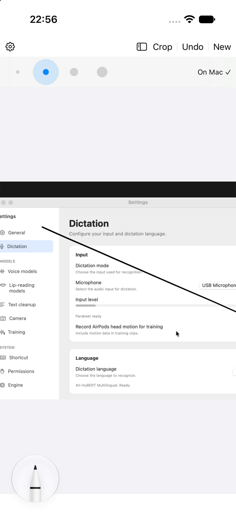

<p align="center">
  
</p>

# DrawMoar

iPhone/iPad companion for [ClipMoar](https://github.com/noma4i/clipmoar): grabs the current Mac screen, lets you draw and crop on it, and copies the result to the Mac clipboard.

<p align="center">
  
</p>

## Requirements

- A Mac with Xcode 15 or newer and its command line tools selected.
- [XcodeGen](https://github.com/yonaskolb/XcodeGen): `brew install xcodegen`.
- An Apple Account signed in under Xcode -> Settings -> Accounts. A free Personal Team works. Its provisioning profile expires after 7 days, so rebuild and reinstall the app. Paid development profiles normally last one year.
- An iPhone or iPad with iOS or iPadOS 17 or newer.
- ClipMoar 1.8.0 or newer on the Mac.

## Mac setup

Install ClipMoar with Homebrew:

```sh
brew tap noma4i/clipmoar https://github.com/noma4i/clipmoar
brew install --cask clipmoar
```

Open ClipMoar -> Settings -> Companion and enable Companion. Grant Screen Recording access. Grant Accessibility access to select parts of windows.

## Build to your device

Connect your iPhone or iPad to the Mac, unlock it, and trust the Mac when prompted. Run:

```sh
scripts/doctor.sh
cp scripts/local.env.example scripts/local.env
```

Edit `scripts/local.env`. Set `DRAWMOAR_TEAM_ID` to your Team ID and `DRAWMOAR_BUNDLE_ID` to a unique bundle ID, such as `com.yourname.DrawMoar`. Find your team in Xcode -> Settings -> Accounts or in your Apple Developer account membership details. `security find-identity -v -p codesigning` can also show the Team ID in an Apple Development certificate name. Environment variables override the local file.

On the device, enable Developer Mode in Settings -> Privacy & Security -> Developer Mode. Restart and confirm the prompt. If the option is missing, connect and pair the device with Xcode first.

```sh
scripts/device.sh
```

If more than one device is connected, pass its name or identifier: `scripts/device.sh "My iPad"`. The script builds, installs, and launches DrawMoar. If the device reports an untrusted developer, follow its trust instructions before opening the app. Allow Local Network access when prompted and allow camera access to scan the QR code.

## Pairing

On the Mac, open ClipMoar -> Settings -> Companion -> Pair device. Scan the QR code with the device camera or the scanner in DrawMoar. Keep the Mac and device on the same local network. Traffic uses TLS with a pre-shared key.

## Share an image

In another app, choose Share -> DrawMoar. The image opens in DrawMoar and is sent to the Mac at once.

The share extension uses App Groups, which requires a paid Apple Developer team. Signing the extension can fail with a free Apple ID.

## How it works

Capture the Mac screen, draw with PencilKit, and crop the image. DrawMoar sends the result to the Mac clipboard 2.5 seconds after the last edit. Press New for another capture.

Choose Window to select a window. Tap again to select a deeper part, or double tap to confirm. Open History on the left to revisit captures or swipe to delete one. Settings includes the paired Mac and display choice (Auto or a fixed display), storage size and retention, and System, Light, or Dark appearance.

## Simulator

Install an iOS simulator runtime in Xcode. With exactly one simulator running, use `scripts/simulator.sh`. Otherwise pass a simulator UDID from `xcrun simctl list devices available`: `scripts/simulator.sh <UDID>`. The script builds and opens the app in Simulator.

## Troubleshooting

- Device missing: connect it by cable, unlock it, trust the Mac, and check Xcode's device list. Run `scripts/doctor.sh` again.
- Untrusted Developer: follow the device's instructions to trust the developer, then launch DrawMoar again.
- App stops opening after 7 days: with a free Personal Team, run `scripts/device.sh` again to rebuild and reinstall.
- Mac not found: confirm both devices use the same local network, Local Network access is enabled for DrawMoar, and the macOS firewall allows ClipMoar.
